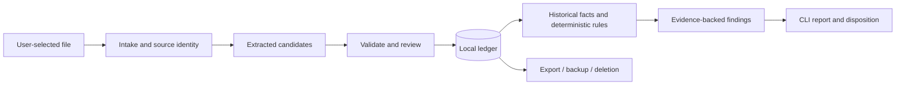

# CreditSentry architecture

## 1. Current implementation

| Boundary | Observed implementation |
|---|---|
| `apps/server` | Hono on Bun, `/health`, planet oRPC procedures and request logging; no financial services or auth |
| `apps/cli` | Remote planet `list`/`create` client; requires the server |
| `apps/web` | React/Vite planet list; not an audit dashboard |
| `packages/api` | Planet schemas/contracts and demo in-memory store |
| `packages/db` | Bun `SQL`, lazy connection, parameterized user queries, one idempotent demo migration |
| `packages/config` | Port/database settings; default DB is in-memory, not durable |
| `packages/utils` | Environment gateway, logger, Zod re-export and shared client utilities |

Source: the corresponding `src/` files and workspace manifests. The current server supplies no
default hostname to `Bun.serve`; it must not be assumed loopback-only because of its comment.
No real statement data should enter this unauthenticated demo. `resetDb` is a destructive test helper,
not a product migration or recovery mechanism. The scaffold has no import/parser/rule pipeline.

## 2. Local workflow (accepted design — ADR-008/010; not yet built)

Keep the current app/package topology. Implement business operations as server-owned modules;
the CLI uses typed RPC and a locally running server. A one-command local launcher can be a later
delivery task, rather than a second execution path bypassing server validation. The initial UI is
the CLI; the existing web app remains a scaffold until a review surface is requested.

| Owner | Planned responsibility |
|---|---|
| `packages/api` | Financial boundary schemas and oRPC contracts; inferred types, no DB or model SDK imports |
| `apps/server` | Intake/extraction, review/admission, historical fact derivation, built-in rules and reports |
| `packages/db` | Financial records, versioned migrations, transactional admission and query operations |
| `packages/config` | Validated local paths, provider consent/configuration and bounded processing settings |
| `apps/cli` | Local workflow commands, review prompts, JSON/text output and actionable errors |
| `apps/web` | Future presentation of the same contracts; no duplicate business logic |

Add the server's DB workspace dependency when the first persisted operation is implemented.
No empty new packages, dynamic plugin kernel, custom orchestration engine or speculative common
repository interface. Extract shared code only when a second real runtime needs it.

## 3. Data flow and recovery (accepted design — ADR-009/010; not yet built)

1. Validate file type, size and selected account before extraction. Hash exact input bytes and keep
   source identity distinct from transaction identity. File paths and merchant text are untrusted.
2. Extract candidate rows with source page/row references. Parse currency/date/decimal values using
   declared format rules, not a guessed locale. Preserve original text and document-level totals.
3. Validate structure, exact amounts, sign, dates, row completeness and available statement totals.
   Classify purchases, refunds, payments, fees and interest separately. Non-USD, encrypted/scanned
   or unreadable inputs return an explicit unsupported/review result in the pilot.
4. Put uncertain or inconsistent candidates into review. Display issues and source evidence; a
   model's self-reported confidence cannot authorize admission. User corrections are versioned and
   preserved when extraction is retried. Admission remains blocked until applicable issues are resolved.
5. Admit a reviewed statement atomically with its transaction/evidence links. A source is complete
   only after commit. Persist attempt state; interruption leaves a resumable/retryable import,
   never a silent partially successful ledger.
6. Separate exact source replay from overlapping exports. Provider transaction IDs, when available,
   dominate identity. Otherwise match account and evidence conservatively; equal merchant/date/
   amount alone cannot erase two legitimate purchases. Ambiguous overlap requires review. Multiple
   source observations may link to one ledger transaction.
7. Derive facts from eligible accepted, posted records in the same account and currency. Evaluate
   versioned built-in rules; persist their input record revisions and coverage window.
8. Give findings a stable identity from rule version, account and sorted evidence IDs. Repeating the
   same audit does not create a new finding or clear its disposition. Corrected inputs invalidate
   affected old findings, which are superseded with traceable replacements.

Corrections are application revisions, not silent source rewrites. Raw-source deletion can remove
page evidence; retain only selected minimal provenance and explain that limitation to the user.

## 4. Audit behavior (accepted design — ADR-009; not yet built)

| Check | Eligible evidence and behavior | Required exclusions / uncertainty |
|---|---|---|
| Possible duplicate | Distinct accepted purchases, same account/currency, conservatively matched merchant and exact amount, within the date window in `04` | File replay and known overlap are ingestion concerns; refunds/payments and pending authorizations excluded; legitimate repeats remain possible |
| Recurring price increase | User-confirmed recurring merchant/account/currency series; compare a new posted charge with prior comparable cycles | Insufficient history is explicit; annual/monthly plans, tax, FX and seat changes cannot be silently treated as comparable or explained as fraud |
| Unfamiliar small charge | First observed eligible merchant charge in available imported history, using the USD threshold in `04` | Informational; incomplete history and legitimate authorization-like activity prevent any claim of confirmed probing |

Historical fact queries belong before rule evaluation; running a rule on only the current amount
and merchant cannot establish duplication or a price change. Use plain deterministic TypeScript
rules first. A declarative rule library is reconsidered only when custom-rule requirements exist.
Reports show compared evidence, parameters, coverage and rule version. They do not invent causes.

## 5. Trust boundaries (accepted design — ADR-008/009; not yet built)

Enforceable requirements for the first financial slice:

- Bind local financial APIs to loopback explicitly; validate Origin/Host and mutation requests so
  a hostile webpage cannot operate a local service. Add a local capability/token where needed;
  loopback binding alone is not a full authorization boundary. No remote exposure before auth design.
- Default to no model egress. Before remote extraction, disclose provider, payload fields and
  retention implications; require explicit consent. Send minimum necessary content and redact
  identifiers where practical, without claiming redaction makes transaction history anonymous.
- Model output can propose rows only. Statement/prompt content cannot invoke tools, SQL, shell,
  downloads or external URLs. No model-driven prompt self-modification or financial actions.
- Bound bytes/pages/rows, model context, retries, elapsed time, concurrency and spend. Handle model
  refusals, truncation, invalid output, rate limits and unavailable providers as explicit failures.
- Do not log statement bodies, account identifiers, tokens or raw model payloads. Use run IDs,
  counts, stages, safe error codes and duration for operational logs. Treat reports/backups as sensitive.
- Keep local data outside source control with owner-only access. Publish retention choices for raw
  sources, extracted content, ledger and reports. Deletion covers application-owned copies and
  explains that original files, user exports, backups and providers require separate handling.
- Do not label the system zero-knowledge. Remote/server-side analysis necessarily processes
  readable content under this design. Ordinary storage encryption has different guarantees.

Hosted identity, tenant query scoping, OAuth token custody, notification delivery and queue recovery
are design prerequisites for E/G, not properties inherited from the scaffold or a future DB adapter.
